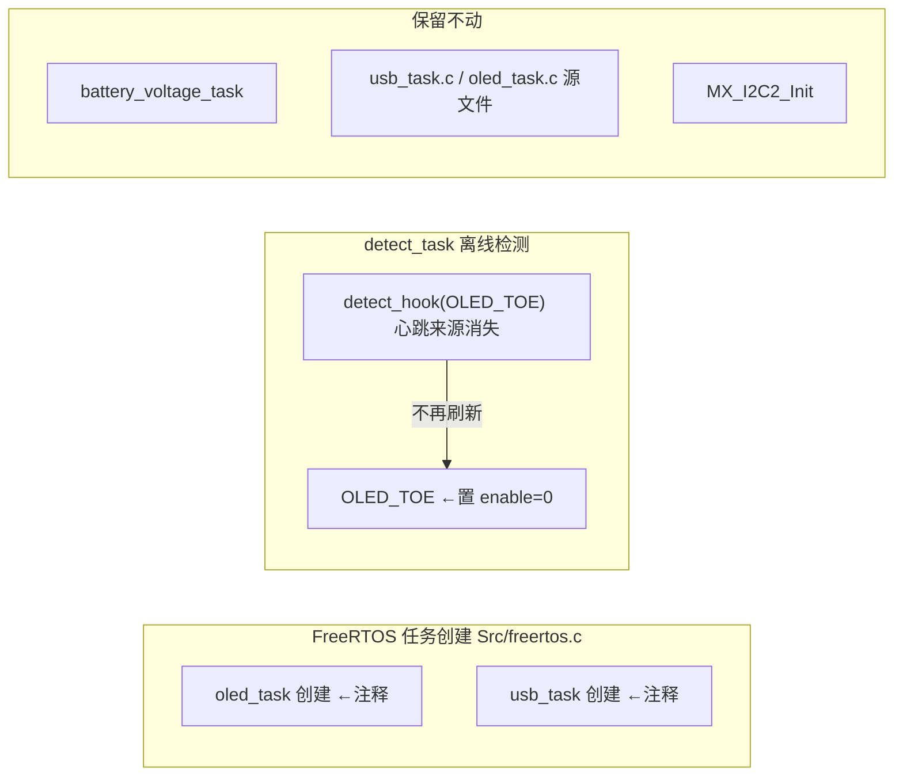

## 产品概述
在 STM32F407 云台标准机器人工程中禁用两个未被使用的调试任务：USB 虚拟串口调试输出任务（usb_task）与 OLED 显示任务（oled_task），释放约 2KB 的 FreeRTOS 任务栈堆内存，同时保证其余功能（离线检测、电机控制、INS 等）不受影响。

## 核心功能
- 注释 `Src/freertos.c` 中 OLED 与 USB 两个任务的创建调用（源文件保留，随时可恢复）
- 在 `detect_task` 中禁用 `OLED_TOE` 离线检测项：任务不再发送心跳后，OLED_TOE 会永远报 ERROR 且周期触发 `OLED_com_reset()` 复位 I2C2，必须一并处理
- 保留 `battery_voltage_task`（OLED/USB 均禁用后其输出暂无消费者，但开销极小且保留可随时恢复显示功能）
- 编译验证工程无错误

## 约束与边界
- 只注释任务创建与 OLED 离线检测项使能，不删除任何源文件或函数
- 不动 `MX_I2C2_Init()`、MX_USB_DEVICE_Init 所在的底层初始化结构
- 不修改与本次改动无关的电机/云台/发射逻辑

## 技术栈
- 现有工程：STM32F407 + FreeRTOS (CMSIS-OS v1) + CubeMX 生成代码 + CMake (arm-none-eabi-gcc)
- 构建验证：CLion 自带 cmake（绝对路径调用）+ Debug preset，目标 SBV

## 实现方案
### 方案说明
仅修改两处代码，改动最小化：
1. `Src/freertos.c`：注释 OLED 任务创建（171-172 行）与 USB 任务创建（179-180 行），各释放 256 字（1KB）任务栈。任务句柄声明（52-55 行）与 `#include` 保留不动，`osThreadDef` 宏注释后不产生代码。
2. `application/detect_task.c`：在 `detect_init()` 中对 `OLED_TOE` 单独置 `enable = 0`（287 行统一 `enable=1` 之后），并注释 298-300 行的 `solve_lost_fun = OLED_com_reset` 绑定，避免无任务心跳时周期性复位 I2C2 总线。

### 关键决策
- **不删源文件只注释创建调用**：与 CubeMX/FreeRTOS 工程惯例一致，恢复成本为零，爆炸半径最小
- **必须处理 OLED_TOE**：oled_task 是 `detect_hook(OLED_TOE)` 的唯一心跳来源，注释任务后该项会永久离线；`error_list[ERROR_LIST_LENGHT]` 汇总项会置位导致"系统存在错误"恒真，且每 100 次 `solve_lost_fun` 调用会触发一次 `bsp_I2C_reset(I2C2)`。置 `enable=0` 后 `detect_task` 主循环直接跳过该项，两个问题同时消除
- **保留 battery_voltage_task**：仅 512B 栈、100ms 周期 ADC 采样，开销可忽略；且电量数据是全局变量，调试器 Watch 仍可用
- **I2C2 独立性已验证**：OLED 专用 I2C2（PF0/PF1），IST8310 磁力计走独立通信（GPIO 模拟 + RSTN/DRDY），禁用不影响姿态解算

### 性能与可靠性
- 改动均为编译期删除任务，运行时零开销增加；总释放约 2KB FreeRTOS 堆
- OLED_TOE 禁用后 `error_list_usb_local[OLED_TOE]` 仍可读（默认值），无野指针风险

### 架构影响

