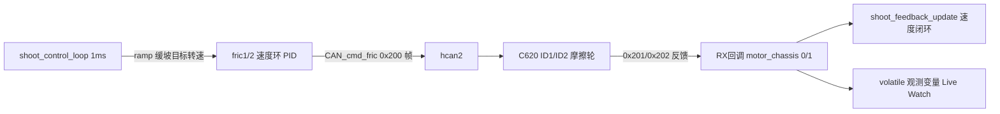

## 产品概述
将 RoboMaster 云台工程的发射机构摩擦轮执行器从 PWM 方案迁移到 CAN 总线方案：两颗 M3508+C620 摩擦轮接 CAN2，电调 ID 1/2（0x201/0x202），采用“斜坡目标转速 + 速度环 PID”闭环控制，沿用现有 shoot 状态机模板（结构体/PID/ramp），摩擦轮转速反馈可在调试器 Live Watch 中实时观察。

## 核心功能
- CAN_receive.c 新增 CAN_cmd_fric()：发 0x200 帧到 hcan2，前两字节携带摩擦轮电流（0x201/0x202），反馈解析零改动
- shoot.c 摩擦轮输出由 PWM ramp 替换为：目标转速经 ramp 缓坡 → 双轮速度环 PID → CAN 电流输出；PID 结构照拨弹电机模板
- 状态机保留：上拨开摩擦轮（缓升到固定转速）/再上拨关（缓降）；转速用宏 FRIC_SPEED_TARGET 可调
- 新增宏 FRIC_POWERON_AUTO（默认 1）：测试阶段上电自动缓升摩擦轮，跳过遥控器开关逻辑；置 0 恢复正常状态机
- 新增转向符号宏 FRIC1/FRIC2_TARGET_SIGN，适配镜像安装的对转方向，经 Live Watch 验证
- gimbal_task 等待云台电机上线改为限时等待，保证测试台架（未接 yaw/pitch）时摩擦轮逻辑仍能运行
- 暴露 volatile 观测变量（两轮转速/电流），供 Live Watch
- 完成后编译验证并汇报完整改动清单


## Tech Stack
- STM32F407 + HAL + FreeRTOS（CMSIS-OS v1）+ CMake（arm-none-eabi-gcc，preset Debug），工程名 standard_robot
- 复用组件：pid.c（PID_POSITION）、user_lib.c（ramp_function_source_t）、CAN_receive.c（motor_measure_t / get_chassis_motor_measure_point）、detect_task（TOE 在线检测）、bsp_fric（仅保留 fric_off 初始化拉低）

## Implementation Approach
### 数据链路


### 关键技术决策
1. **0x200 帧走 hcan2**：电调 ID 1/2 只响应 0x200 帧，现有 0x1FF 帧槽位被 yaw/pitch/拨弹占用，必须新增发送函数；使用独立 tx header/数据缓冲，避免与 CAN1 的 chassis_tx_message 竞态
2. **反馈零改动**：HAL_CAN_RxFifo0MsgPendingCallback 按 StdId 解析，CAN1/CAN2 共用回调，0x201/0x202 自动进 motor_chassis[0/1] 并刷新 CHASSIS_MOTOR1/2_TOE
3. **结构替换而非新增任务**：shoot_control_t 中 fric1_ramp/fric2_ramp/fric_pwm1/fric_pwm2 字段替换为 fric_speed_ramp + 双轮速度 PID + 电机反馈指针；状态机切换条件 `fric1_ramp.out==max_value` 改为 `fric_speed_ramp.out==max_value`（shoot.c:231）
4. **上电自动转用宏门控**：FRIC_POWERON_AUTO=1 时 shoot_init 直接置 SHOOT_READY_FRIC 且 shoot_set_mode 跳过遥控器拨杆判断（DBUS 离线 rc 数据为 0 不会误触发）；gimbal_task 的 CAN_cmd_gimbal 离线发零逻辑（gimbal_task.c:355-365）不受影响，拨弹仍走 0x1FF 帧
5. **限时等待云台电机**：gimbal_task.c:329-333 的死等循环改为约 2s 超时（计次），否则测试台架未接 yaw/pitch 时 shoot_control_loop 永远执行不到
6. **转向适配**：镜像安装导致两轮反馈符号相反，目标转速 = FRICx_TARGET_SIGN × fric_speed_ramp.out，默认 +1/-1，经 Live Watch 验证后可改宏；PID 闭环下方向错误表现为转速闭环到错误符号，改宏即修正

### 关键参数（初始安全值，均可宏调）
- FRIC_SPEED_TARGET 4500.0f rpm；FRIC_SPEED_RAMP_ADD 5.0f/1ms（约 1s 升满）
- 摩擦轮速度环 PID：kp=12.0 ki=0.1 kd=0，MAX_OUT 10000（C620 电流限幅）、MAX_IOUT 5000
- SHOOT_STOP 时 ramp 负向步进缓降，全程闭环输出，无电流突跳

### 性能与可靠性
- 控制周期沿用 1ms（SHOOT_CONTROL_TIME），每周期仅一次 CAN 发送 + 两次 PID，负载可忽略
- 安全约束：电流限幅 MAX_OUT 10000、ramp 缓坡、反馈离线（toe_is_error）时 PID 目标按 SHOOT_STOP 处理并置零输出
- PWM 残留清理：删除 fric PWM 宏与 shoot_fric1/2_on 调用，shoot_init 保留一次 fric_off() 确保引脚拉低，不引入功能回归
- 爆炸半径控制：CAN_receive.c 只增不改；shoot.c 仅替换摩擦轮执行器链路，拨弹/热量/堵转反转逻辑不动；无新增文件，CMakeLists 无需变更

## Directory Structure Summary
```
application/
├── CAN_receive.h   # [MODIFY] 声明 CAN_cmd_fric(int16_t fric1, int16_t fric2)
├── CAN_receive.c   # [MODIFY] 新增 fric 0x200 帧发送（独立 fric_tx_message/fric_can_send_data，走 GIMBAL_CAN/hcan2）
├── shoot.h         # [MODIFY] 新增转速/PID/斜坡/上电自动/转向符号宏；shoot_control_t 替换 PWM 字段为 fric_speed_ramp、fric_speed_pid[2]、fric_motor_measure[2]、fric_speed[2]、fric_current[2]
├── shoot.c         # [MODIFY] shoot_init 初始化 PID/ramp/指针（FRIC_POWERON_AUTO 置 READY_FRIC）；shoot_feedback_update 读取两轮 speed_rpm；shoot_control_loop 替换 PWM 输出为 ramp→PID→CAN_cmd_fric；shoot_set_mode 增加宏门控跳过拨杆逻辑；删除 PWM 宏与 fric PWM 输出；新增 volatile 观测变量 fric_watch_speed1/2、fric_watch_current1/2
└── gimbal_task.c   # [MODIFY] 329-333 行死等循环改为限时等待（约 2s 超时后继续，超时期间保持反馈更新）
```

