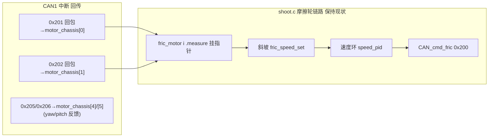

## 需求说明
用户正在调试双摩擦轮（M3508+C620，CAN1，电调ID 1/2，0x201/0x202），通过调试器监视 `shoot_control_t`（发射控制）结构体时发现异常，并否定了此前"加保护、加观测变量"的方案。

用户明确要求：
1. **先捋清流程再动代码**：把云台已正常工作的 Yaw/Pitch 电机完整流程（PID 初始化、反馈回传、控制链路）捋一遍，对照摩擦轮的设置，判断哪些需要、哪些不需要。
2. **不要加任何保护和新增观测变量**：`shoot.c:73-77` 的 `fric_watch_*` 是冗余的复制变量，用户不需要，直接删除；一切观测通过 `shoot_control` 结构体本体完成。
3. **确认 PID 初始化存在**：上电后摩擦轮/拨弹/云台的 PID 是否都有初始化（已核实存在，需向用户讲清位置）。

### 已核实的疑问解答（交付内容，不改代码）
- **射击模式**：`shoot_set_mode()` (shoot.c:235)，由 `FRIC_POWERON_AUTO=1` (shoot.h:36) 决定上电自动进 `SHOOT_READY_FRIC`，跳过遥控器开关与云台无力停射逻辑 (shoot.c:339)。
- **云台模式**：`gimbal_set_mode()` (gimbal_task.c:691) → `gimbal_behaviour_mode_set()` (gimbal_behaviour.c:291)，遥控器通道0决定行为状态机。
- **上电时序**：gimbal_task 等201ms → `gimbal_init` (gimbal_task.c:323) → `shoot_init` (gimbal_task.c:326)；云台初始 `GIMBAL_MOTOR_RAW`，遥控器离线时 `GIMBAL_ZERO_FORCE` 无力且 0x1FF 发0 (gimbal_task.c:357-359)；射击上电即斜坡 0→4500rpm（5rpm/ms，0.9s 升满，此为 `fric_speed_set` "一直增长"的设计行为），摩擦轮 0x200 帧不受遥控器离线影响。
- **PID 初始化确认存在**：shoot.c:102（拨弹）、shoot.c:107-108（两摩擦轮速度环）；gimbal_task.c:656-662（yaw/pitch 各3个PID）+ 665行清零。
- **电机回传数据**：`fric_motor_t` (shoot.h:112-118) 的 `measure` 指针指向 CAN 中断填写的 `motor_chassis[0]/[1]`（0x201/0x202 回包，含 ecd/speed_rpm/given_current/temperate）。

### 摩擦轮流程对照结论（无需结构性修改）
摩擦轮流程与云台电机同构且完整：反馈指针 (shoot.c:106) → PID 初始化 (shoot.c:107-108，单级速度环，摩擦轮无需角度环) → 斜坡目标 fric_speed_ramp → fric_speed_set (shoot.c:211) → PID_calc (shoot.c:212-217) → CAN_cmd_fric 0x200 (shoot.c:219)。唯一需要清理的是 `fric_watch_*` 冗余观测变量。

### 用户后续观测口径（调试指导，不改代码）
- 摩擦轮回传转速：`fric_motor[i].measure->speed_rpm`
- PID 运行状态：`fric_motor[i].speed_pid` 的 set/get/err/out
- 发送电流：`fric_motor[i].current`
- 一号轮 <100rpm：看 `fric_motor[0].measure->speed_rpm` 是否恒0（0x201 电调无反馈/ID不符）
- 二号轮 9000rpm：看 `fric_motor[1].speed_pid.out` 是否顶饱和 ±10000（正反馈失控/TARGET_SIGN 与实际转向不匹配）

## 技术栈
- 现有工程：STM32F407 + FreeRTOS + HAL，C 语言，CMake 构建（preset Debug），arm-none-eabi-gcc 工具链。
- 完全复用现有架构，零新增模式。

## 实现方案
### 改动范围（最小化）
仅删除 `fric_watch_*` 冗余观测变量，共三个位置：
1. `application/shoot.c:73-77`：4 个 `volatile int16_t` 定义
2. `application/shoot.c:221-225`：主循环尾部每周期赋值语句
3. `application/shoot.h:160-164`：extern 声明与注释

已确认全工程无其他文件引用（usb_task.c 等均未引用），删除无副作用、不改变任何控制行为。

### 不做的事（用户明确要求）
- 不加反馈缺失/失控保护逻辑
- 不新增任何观测变量、调试宏
- 不修改 PID 参数、TARGET_SIGN、斜坡参数
- 不改动云台/拨弹/状态机任何逻辑

### 构建验证
使用本机绝对路径工具链编译验证（不依赖 PATH）：
`C:\Users\PoXia\AppData\Local\Programs\CLion\bin\cmake\win\x64\bin\cmake.exe --build --preset Debug`，并 read_lints 确认无错误。

## 架构说明

摩擦轮控制链路保持与云台电机同构（反馈指针→PID→发送），本次仅移除观测旁路，无架构变化。

