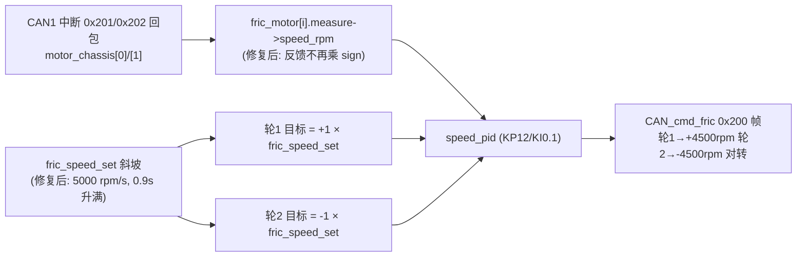

## 需求说明
用户通过调试器观察 `shoot_control` 结构体，实测数据已确诊摩擦轮两个 Bug，要求修复：

### 实测现象与根因对应
1. **一号轮（0x201，target_sign=+1）转速 200~300 rpm**——它正在正常跟踪同样只有 ~300 的 `fric_speed_set`，闭环本身工作正常；慢的根源是斜坡增速比设计慢了 1000 倍。
2. **二号轮（0x202，target_sign=-1）恒 -9000 多 rpm**——M3508 转子空载极限，速度环正反馈失控确诊：目标与反馈都乘了 -1，误差符号被翻转，输出越推越偏。
3. **`fric_speed_set` 观察很久仍 300 多**——印证 Bug①：`ramp_calc` 语义是“输入单位为 /s"（user_lib.c:42 注释），而 `FRIC_SPEED_RAMP_ADD_VALUE=5.0f` 被当成 rpm/ms 用，实际 5 rpm/s，升到 4500 需 900 秒而非 0.9 秒；SHOOT_STOP 降速同样慢 1000 倍。
4. **PID 显示 P=12、I=0.1**——PID_init 正常执行，此前“PID 全零”为监视位置问题，已排除，不动 PID 参数。

## 修复目标
- 修正斜坡单位：5 rpm/s → 5000 rpm/s，0.9 秒升满/降完（连带 `READY_FRIC→READY_BULLET` 切换条件恢复正常触发时机）。
- 修正二号轮正反馈：反馈不再乘 `target_sign`，仅目标乘符号，二号轮收敛到 -4500 rpm（与一号轮天然对转）。
- 删除 4 个冗余 `fric_watch_*` 观测变量，观测统一走 `shoot_control.fric_motor[i]` 本体。

## 不做的事（用户明确要求）
- 不加失控保护；不改 PID 参数（KP12/KI0.1 已验证工作）；不动云台/拨弹/状态机逻辑；`FRIC_POWERON_AUTO` 保持 1。

## 技术方案
- 现有工程：STM32F407 + FreeRTOS + HAL，C 语言，CMake（preset Debug），arm-none-eabi-gcc 工具链。仅改 application/shoot.c 与 application/shoot.h，零新增文件、零新增模式。

### Bug① 斜坡单位修正（已核实代码）
- `shoot.c:115` `ramp_init(&fric_speed_ramp, SHOOT_CONTROL_TIME*0.001f, FRIC_SPEED_TARGET, 0.0f)`，frame_period=0.001s。
- `user_lib.c:42-54` `ramp_calc`：`out += input * frame_period`，注释明确“输入单位为 /s"。
- `shoot.h:39` 宏 `FRIC_SPEED_RAMP_ADD_VALUE 5.0f` 注释却写"rpm/1ms"。
- 修法：宏改为 `5000.0f`，注释更正为 "rpm/s"，保持 ramp 语义诚实；升满 0.9s、SHOOT_STOP 降完同样 0.9s。
- 连带确认：`shoot.c:246-250/276-279` 的 `READY_FRIC→READY_BULLET` 条件 `fric_speed_ramp.out == max_value` 修复后 0.9s 即达成，无需改动。

### Bug② 反馈符号修正（已核实代码）
- 现状 `shoot.c:212-217`：`PID_calc(&speed_pid, target_sign * speed_rpm, target_sign * fric_speed_set)`，err = sign×(set−rpm)，符号被同时乘进误差两侧。
- 数学依据：输出电流对转速的增益 K>0 恒定（一号轮 sign=+1 稳定收敛证明）；sign=−1 时闭环增益为正 → 必然失控，与实测 -9000 吻合。
- 修法：反馈直接用 `measure->speed_rpm`，仅目标乘 `target_sign`：`PID_calc(&speed_pid, (fp32)speed_rpm, target_sign * fric_speed_set)`。二号轮收敛 −4500 rpm、一号轮 +4500 rpm，两轮对转，方向仍由 `FRICx_TARGET_SIGN` 宏调节。
- `shoot.h:40-41` 注释同步更正（说明 sign 只作用于目标转速）。

### 附带清理
- 删 `shoot.c:73-77` 定义、`shoot.c:221-225` 赋值、`shoot.h:160-164` extern 的 `fric_watch_*`（已 grep 确认全工程无其他引用）。

### 构建验证
- 绝对路径构建：`C:\Users\PoXia\AppData\Local\Programs\CLion\bin\cmake\win\x64\bin\cmake.exe --build --preset Debug`（失败时换用 `C:\ST\STM32CubeCLT_1.18.0\CMake\bin\cmake.exe`），read_lints 确认无错误。

