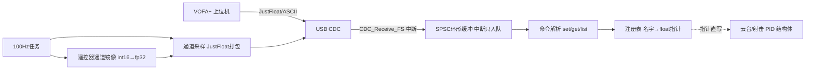

## 产品概述
为云台工程封装 VOFA+ 上位机调参模块（单文件模块 `application/vofa_task.c/h`）：通过板载 USB CDC 虚拟串口实现「上行波形监看 + 下行在线调 PID」。要求高内聚封装，对外只暴露少量函数，尽量少改动现有代码。

## 核心功能
- **封装为独立模块**：接收、解析、发送、注册表、FreeRTOS 任务全部收进 `vofa_task.c`（internal static），其他模块只调用对外的 3 个注册 API。
- **监看（上行）**：100Hz 周期将注册的观测通道打包为 JustFloat 帧（帧尾 `00 00 80 7F`）发送，VOFA+ 直接绘制波形。
- **调参（下行）**：解析 `\n` 结尾 ASCII 命令：`set <名字> <值>`、`get <名字>`、`list`，指针直写 PID 结构体成员立即生效，并文本回显。
- **遥控器通道监看**：vofa_task 启动时自动注册遥控器通道（ch0~ch4、拨杆 s[0]~s[1]、鼠标/键盘镜像值），调试时用遥控器摇杆/拨杆控制目标值做阶跃激励，无需 vofa 接管目标。
- **PID 参数机制**：上电仍用原宏初始化（安全兜底）；VOFA 下发的值指针直写覆盖 =「暂时不用宏」；调好后写回宏固化；断电不保存。

## 边界约束
- 删除 vofa_override_apply 覆盖点方案：目标值由遥控器控制，gimbal_task.c 控制逻辑零改动。
- 云台控制逻辑、PID 库、test_task 均不改。
	


## 技术栈
- C 语言 + STM32F407 HAL + FreeRTOS（CMSIS-OS v1，`osThreadCreate` 模式，Src/freertos.c:146）
- 传输层：USB CDC 虚拟串口（Src/usbd_cdc_if.c 已有 `CDC_Receive_FS`/`CDC_Transmit_FS`，无需新硬件）
- 上行协议：VOFA+ JustFloat；下行协议：`\n` 结尾 ASCII 命令
- 构建验证：CLion 绝对路径 `cmake.exe --build --target SBV --preset Debug`

## 架构设计
单模块内部分层（同文件 static 隔离，对外仅 3 个 API）：



## 对外接口（vofa_task.h）
```c
void  vofa_task(void const *argument);                       // RTOS任务入口
bool_t vofa_reg_param(const char *name, fp32 *addr);         // 注册可调参数
bool_t vofa_reg_channel(const char *name, const fp32 *addr); // 注册监看通道
bool_t vofa_reg_pid(const char *prefix, void *pid, uint8_t pid_kind); // 一键注册整组PID
```

## 关键实现决策
1. **指针直绑而非复制**：注册 `&pid.Kp` 等成员地址，`set` 即写即生效；Cortex-M4 对齐 fp32 写入原子，无撕裂，无需加锁。
2. **RX 用 SPSC 环形缓冲**：`CDC_Receive_FS`（USB 中断）只 copy 入队，任务侧逐字节解析，中断时间最短。
3. **遥控器通道 int16→fp32 镜像**：`get_remote_control_point()`（remote_control.h:83，gimbal_task.c 已有现成用法）取 RC 指针，vofa_task 每周期把 `rc.ch[0..4]`、`rc.s[0..1]`、`mouse.x/y/z`、`key.v` 拷入内部 fp32 镜像变量后注册为监看通道，不改注册表 API 类型。
4. **vofa_task 内自动绑定云台**：通过已有 `get_yaw_motor_point()/get_pitch_motor_point()` 注册 yaw/pitch 角度环（gimbal_PID_t）与速度环（pid_type_def）全部参数及 set/get/gyro/out 观测通道。
5. **shoot 静态结构**：shoot.c 的 shoot_control_t 为静态变量，在 shoot.c 内新增约 10 行 `vofa_shoot_register()` 注册入口完成摩擦轮/拨弹 PID 与通道注册。
6. usb_task.c 停用 1s 打印（保留任务壳与 `MX_USB_DEVICE_Init`）。

## 性能与可靠性
- 100Hz × N 通道打包发送；CDC_BUSY 时丢帧不阻塞控制任务。
- 命令解析器为逐字节状态机，天然处理粘包/断包；非法命令忽略并回显错误提示。
- JustFloat 帧与文本回显共存，VOFA+ JustFloat 引擎自动忽略非帧尾数据。

## 修改文件清单
```
application/vofa_task.c/h   [NEW] 全部 VOFA 逻辑：注册表/协议/环形缓冲/任务/绑定/RC通道镜像
Src/usbd_cdc_if.c           [MOD] CDC_Receive_FS USER CODE 段挂一行 vofa_cdc_rx_handler
application/usb_task.c      [MOD] 停用 1s 诊断打印
application/shoot.c/.h      [MOD] 新增 vofa_shoot_register() 注册入口
Src/freertos.c              [MOD] 创建 vofa_task（osPriorityNormal，栈512）
CMakeLists.txt              [MOD] 加入 application/vofa_task.c
```
	
