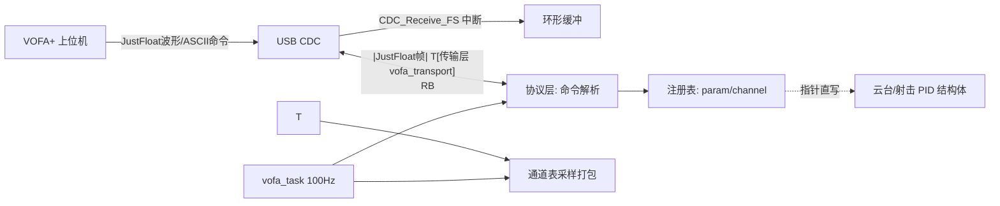

## 产品概述
为云台工程新增 VOFA+ 上位机调参模块：通过板载 USB CDC 虚拟串口与 VOFA+ 通信，实现「上行监看 + 下行调参」，重点是 PID 在线整定，要求高度模块化、可扩展到任意浮点参数。

## 核心功能
- **监看（上行）**：以 100Hz 周期将注册的观测通道（云台 yaw/pitch 角度环与速度环的 set/get/gyro/out、摩擦轮转速/电流等）打包为 JustFloat 帧（帧尾 0x00 0x00 0x80 0x7F）发送，VOFA+ 直接绘制波形。
- **调参（下行）**：解析 VOFA+ 命令按钮/串口发送的 ASCII 命令（'\n' 结尾）：`set <参数名> <值>`（如 `set yaw_spd_kp 3600.0`）、`get <参数名>`、`list`，直接写入 PID 结构体成员，立即生效，并文本回显结果。
- **参数注册表**：任意模块可按 `名字 → float*` 注册可调参数（Kp/Ki/Kd/max_out/max_iout 等）与观测通道，新增被调对象零协议改动。
- **收发解耦**：USB 中断只搬字节进环形缓冲，解析在任务上下文执行。
- **解决 CDC 占用冲突**：原 usb_task 每 1s 的诊断打印让位于 VOFA。


## 技术栈
- C 语言 + STM32F407 HAL + FreeRTOS（CMSIS-OS v1，osThreadCreate 模式，见 Src/freertos.c:145-186）
- 传输层：USB CDC 虚拟串口（Src/usbd_cdc_if.c 已有 CDC_Receive_FS/CDC_Transmit_FS，无需新硬件）
- 上行协议：VOFA+ JustFloat；下行协议：'\n' 结尾 ASCII 命令（VOFA+ 命令按钮原生支持）
- 构建验证：cmake.exe --build --target SBV --preset Debug（CLion 工具链，绝对路径）

## 实现方案
分层解耦：**传输层**（字节收发 + RX 环形缓冲，中断只入队）→ **协议层**（JustFloat 打包 + 命令解析）→ **注册表层**（参数表/通道表，名字绑定 float 指针，支持写后回调）→ **任务层**（100Hz 采样发送 + RX 消费执行 + 绑定云台/射击 PID）。

关键决策：
1. **指针直绑而非复制**：注册 `&pid.Kp` 等成员地址，写入即时生效，控制代码零改动；Cortex-M4 对齐 fp32 写入原子，无撕裂风险。
2. **RX 用 SPSC 环形缓冲**：CDC_Receive_FS（USB 中断）只 copy 入队，任务侧出队解析，中断时间最短。
3. **JustFloat 与文本共存**：VOFA+ JustFloat 引擎自动忽略非帧尾数据，命令回显文本可直接在命令窗口查看。
4. 云台角度环用 gimbal_PID_t（gimbal_task.h:168）、速度环用 pid_type_def，两种结构体通过成员指针统一注册，无需改 PID 库；shoot_control_t 为 shoot.c 静态变量，绑定代码放在 vofa 绑定文件中利用已有 get_yaw_motor_point()/get_pitch_motor_point() 与 fric_watch_* 外部变量，shoot.c 仅需补一个注册入口函数。



## 目录结构
```
application/vofa/
├── vofa_transport.h/.c   # [NEW] 字节收发抽象：send()、RX环形缓冲、vofa_cdc_rx_handler()
├── vofa_protocol.h/.c    # [NEW] JustFloat 打包发送 + ASCII 命令解析执行
├── vofa_registry.h/.c    # [NEW] 参数注册表 + 监看通道注册表（名字→float*）
├── vofa_bind.h/.c        # [NEW] 绑定云台 yaw/pitch 角度环+速度环 PID、观测通道、射击摩擦轮/拨弹 PID 与 fric_watch_*
└── vofa_task.h/.c        # [NEW] FreeRTOS 任务：10ms 采样发送 + RX 消费；USB 设备初始化入口
```

需修改文件：
- `Src/usbd_cdc_if.c`：CDC_Receive_FS USER CODE 段调用 `vofa_cdc_rx_handler(Buf, *Len)`
- `application/usb_task.c`：去掉每 1s 诊断打印（或宏开关关闭），避免占用 CDC
- `Src/freertos.c`：创建 vofa_task（osPriorityNormal，栈 512）
- `CMakeLists.txt`：将 application/vofa/*.c 加入编译源（按现有源文件组织方式）
- `application/shoot.c`：新增 `vofa_bind_shoot(shoot_control_t*)` 注册入口（约 10 行，不动控制逻辑）

## 关键接口
```c
// vofa_registry.h
typedef void (*vofa_write_cb_t)(const char *name);
bool_t vofa_reg_param(const char *name, fp32 *addr, vofa_write_cb_t on_write);
bool_t vofa_reg_channel(const char *name, const fp32 *addr);
// 协议命令: "set <name> <val>\n" / "get <name>\n" / "list\n"，回显文本经 transport 发出
```

