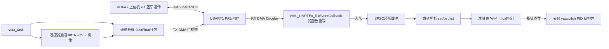

## 产品概述
为云台工程封装 VOFA+ 上位机调参模块（单模块 `application/vofa_task.c/h`），通过 USART1 蓝牙串口（大夏龙雀 DX-BT36/37 透传）实现「上行波形监看 + 下行在线调 PID」，重点服务云台 PID 整定。

## 核心功能
- **监看（上行）**：以 `VOFA_SEND_HZ`（默认 50Hz 宏可调）周期将注册的观测通道打包 JustFloat 帧（帧尾 `00 00 80 7F`）经 USART1 TX DMA 发出，VOFA+ 绘制波形。
- **调参（下行）**：USART1 RX DMA 循环模式 + `HAL_UARTEx_RxEventCallback` 收数据，逐字节状态机解析 `\n` 结尾 ASCII 命令：`set <名字> <值>`、`get <名字>`、`list`，指针直写 PID 结构体成员立即生效，文本回显。
- **遥控器通道监看**：自动注册 ch0~ch4、拨杆 s[0]~s[1]、鼠标/键盘镜像值，调试时用遥控器做激励，不需要 vofa 接管目标值。
- **PID 机制**：上电仍用宏初始化（安全兜底）；VOFA 下发值指针直写覆盖＝「暂时不用宏」；调好后写回宏固化；断电不保存。
- **云台自动绑定**：vofa_task 内通过 `get_yaw_motor_point()/get_pitch_motor_point()` 注册 yaw/pitch 角度环（gimbal_PID_t）与速度环（pid_type_def）全部参数及 set/get/gyro/out 观测通道。

## 边界约束（用户明确）
- 串口外设配置（USART1 RX DMA Circular + NVIC）由用户在 CubeMX 完成，代码不碰任何 CubeMX 生成文件（usart.c、stm32f4xx_it.c、bsp_usart.c 均不改），只用标准 HAL API。
- 波特率固定 115200，不做宏、不改 usart.c。
- 射击（shoot.c）注册入口本轮不做，待确定要调哪个 PID 后再加。
- USB 已禁用，usb_task/usbd_cdc_if 一律不动；USART3（DBUS）、USART6（裁判）不动。
- remote_control.c 仅用宏开关关闭 sbus_to_usart1 转发（释放 USART1 TX，功能可一键恢复）。

## 蓝牙模块配置说明（用户侧操作）
DX-BT36/37 出厂默认 9600，需 AT 命令改 115200：串口助手发 `AT+BAUD7`（\r\n 结尾，仅蓝牙未连接时响应）；`AT+BLUFISEND=1` 开透传；双模块方案：一块接板子 USART1，一块接 USB-TTL 接电脑，`AT+INQ`→`AT+CONN1`→`AT+BIND<mac>` 绑定后自动重连，VOFA+ 打开 USB-TTL 的 COM 口（协议选 JustFloat）。


## 技术栈
- C + STM32F407 HAL + FreeRTOS（CMSIS-OS v1，osThreadCreate 模式，Src/freertos.c:146）
- 传输层：USART1（115200，PA9/PB7）；RX：用户 CubeMX 配 DMA2_Stream5 循环模式 + USART1 全局中断，代码侧 `HAL_UART_Receive_DMA` 启动 + 重写弱函数 `HAL_UARTEx_RxEventCallback`；TX：复用现有 `usart1_tx_dma_enable`（bsp_usart.c:33，main.c:148 已 init），发送前检查 `hdma_usart1_tx` 的 EN/NDTR 忙状态，忙则丢帧不阻塞
- 上行协议：VOFA+ JustFloat；下行协议：`\n` 结尾 ASCII 命令；文本回显与波形共存（VOFA+ JustFloat 引擎忽略非帧尾数据）
- 构建验证：CLion 绝对路径 `cmake.exe --build --target SBV --preset Debug`

## 架构设计
单文件模块内 static 隔离分层，对外仅 3 个 API + 任务入口：



## 关键实现决策
1. **指针直绑而非复制**：注册 `&pid.Kp` 等成员地址，set 即写即生效；Cortex-M4 对齐 fp32 写原子，无锁。
2. **RX 全在 vofa_task.c**：`HAL_UARTEx_RxEventCallback` 是全局弱函数，USART3(DBUS)/USART6(裁判) 均为寄存器级手动处理不经过 HAL 回调，重写无冲突；Circular 模式用 Size 与上次差值算新数据长度，搬入 SPSC 环形缓冲，任务侧逐字节解析，天然处理粘包/断包。
3. **TX 忙检查**：复用现有 usart1_tx_dma_enable，前检查 DMA EN 位与 NDTR，忙丢帧。
4. **遥控器镜像**：`get_remote_control_point()` 取 RC 指针，每周期把 ch/s/mouse/key 拷入内部 fp32 镜像后注册为监看通道（不改注册表 API 类型）。
5. **云台绑定**：vofa_task 启动时绑定 yaw/pitch 角度环与速度环（pid_kind 区分两种结构体）共 20 个参数 + 观测通道；shoot 留待后续。
6. **性能**：115200 下 10 通道 100Hz ≈ 44kbps；但 BLE 透传空中吞吐仅几 KB/s，故 `VOFA_SEND_HZ` 默认 50，宏可调。

## 修改文件清单
```
application/vofa_task.c/h    [NEW] 全部 VOFA 逻辑：注册表/协议/环形缓冲/HAL回调/任务/云台绑定/RC镜像
application/remote_control.c [MOD] SBUS_FORWARD_TO_USART1 宏(默认0)关闭两处转发，释放 USART1 TX
Src/freertos.c               [MOD] 创建 vofa_task（osPriorityNormal，栈512）
CMakeLists.txt               [MOD] 加入 application/vofa_task.c
```
用户侧：CubeMX 配 USART1 RX DMA(Circular)+NVIC；两个蓝牙模块 AT+BAUD7 改 115200 并绑定配对。

