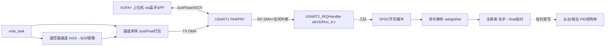

## 产品概述
为云台工程封装 VOFA+ 上位机调参模块（单模块 `application/vofa_task.c/h`），通过 USART1 蓝牙串口实现「上行波形监看 + 下行在线调 PID」。高内聚封装，对外仅 3 个注册 API，尽量少改动现有代码。

## 用户疑问解答（已确认的事实）
- **"哪个任务在用 USART1"**：是 `remote_control.c`（遥控任务）里的 `sbus_to_usart1()`（remote_control.c:291）。它在 USART3 的 DBUS 接收中断里被调用（:189、:221），每收到一帧遥控数据（14ms 一次）就把 18 字节遥控数据打包成 20 字节（帧头 0xA6 + 18 字节数据 + 1 字节校验和）从 USART1 TX 转发出去。
- **"SBUS 是什么玩意"**：SBUS 是 DJI 遥控器（DT7/DR16）使用的串口通信协议格式，DBUS 接收机收到的就是 SBUS 协议数据。这个转发功能一般用于把遥控数据发给图传模块或另一块板子，你没有接这类设备，**该功能可以关闭，把 USART1 TX 完整让给 VOFA**。
- **"9600 带宽紧张吗、要不要改波特率"**：紧张。9600bps ≈ 960 字节/s，10 个波形通道每帧 44 字节，最多只能跑约 20 帧/s，波形会明显卡顿。**建议用 AT 命令把蓝牙模块改到 115200**（多数模块 `AT+BAUD8` 或 `AT+UART=115200,0,0`，改完模块自动保存）。代码侧把波特率与发送频率做成宏（`VOFA_BAUDRATE=115200`、`VOFA_SEND_HZ=100`），即使暂时用 9600，把 `VOFA_SEND_HZ` 降到 20 也能凑合用。

## 核心功能
- **监看（上行）**：以 `VOFA_SEND_HZ` 周期将注册的观测通道打包 JustFloat 帧（帧尾 `00 00 80 7F`）经 USART1 TX DMA 发出，VOFA+ 绘制波形。
- **调参（下行）**：蓝牙 RX（DMA + 空闲中断）接收 ASCII 命令：`set <名字> <值>` / `get <名字>` / `list`，指针直写 PID 结构体成员立即生效，文本回显。
- **遥控器通道监看**：自动注册 ch0~ch4、拨杆 s[0]~s[1]、鼠标/键盘镜像值，调试时用遥控器做激励。
- **PID 机制**：上电仍用宏初始化（安全兜底），VOFA 下发值指针直写覆盖，调好后写回宏固化，断电不保存。
- **云台自动绑定 + 射击注册入口**：vofa_task 内注册云台 yaw/pitch 角度环与速度环全部参数及观测通道；shoot.c 新增约 10 行注册入口。

## 边界约束
- gimbal_task.c 控制逻辑、PID 库、test_task、usb_task、usbd_cdc_if 均不改（USB 已禁用）。
- USART3（DBUS）、USART6（裁判系统）不动。
- remote_control.c 仅用宏开关关闭 sbus_to_usart1 转发调用（释放 TX，功能保留可一键恢复）。


## 技术栈
- C + STM32F407 HAL + FreeRTOS（CMSIS-OS v1，osThreadCreate 模式）
- 传输层：USART1（115200，PA9/PB7）RX DMA + 空闲中断接收，TX DMA 发送（bsp_usart.c 已有 usart1_tx_dma_init/usart1_tx_dma_enable）
- 上行协议：VOFA+ JustFloat；下行协议：'\n' 结尾 ASCII 命令
- 构建验证：CLion 绝对路径 cmake.exe --build --target SBV --preset Debug

## 架构设计
单模块内部分层（同文件 static 隔离，对外仅 3 个 API）：



## 关键实现决策
1. **指针直绑而非复制**：注册 `&pid.Kp` 等成员地址，set 即写即生效；Cortex-M4 对齐 fp32 写原子，无锁。
2. **RX DMA 接收**：bsp_usart.c 新增 `usart1_rx_dma_init()`（手动构造 `DMA_HandleTypeDef` 走 `HAL_DMA_Init` + `HAL_UART_Receive_DMA` 循环模式 + 使能空闲中断，USART1_RX 为 DMA2_Stream5_Channel4，无需重新生成 CubeMX 代码）；stm32f4xx_it.c 新增 `USART1_IRQHandler`：空闲中断里按 NDTR 差值算长度、搬入 SPSC 环形缓冲，任务侧逐字节解析，天然处理粘包。
3. **TX 忙检查**：发送前检查 `hdma_usart1_tx` 的 EN/NDTR，忙则丢帧不阻塞；复用现有 usart1_tx_dma_enable。
4. **波特率/频率宏化**：`VOFA_BAUDRATE`（同步改 Src/usart.c MX_USART1_UART_Init 的 BaudRate）与 `VOFA_SEND_HZ`；9600 时降频使用。
5. **释放 TX**：remote_control.c 用 `SBUS_FORWARD_TO_USART1` 宏（默认 0）关掉两处 sbus_to_usart1 调用。
6. **遥控器镜像**：`get_remote_control_point()` 取 RC 指针，每周期把 ch/s/mouse/key 拷入内部 fp32 镜像后注册为监看通道。
7. **云台自动绑定**：get_yaw_motor_point()/get_pitch_motor_point() 注册角度环（gimbal_PID_t）与速度环（pid_type_def）Kp/Ki/Kd/max_out/max_iout 及 set/get/gyro/out 通道；pid_kind 参数区分两种结构体。
8. **shoot 静态结构**：shoot.c 新增 `vofa_shoot_register()` 注册摩擦轮/拨弹 PID 与通道。

## 对外接口
```c
void   vofa_task(void const *argument);                        // RTOS 任务入口
bool_t vofa_reg_param(const char *name, fp32 *addr);           // 注册可调参数
bool_t vofa_reg_channel(const char *name, const fp32 *addr);   // 注册监看通道
bool_t vofa_reg_pid(const char *prefix, void *pid, uint8_t pid_kind); // 一键注册整组PID
```

## 性能与可靠性
- 115200 下 10 通道 100Hz ≈ 44kbps，余量充足；9600 时 VOFA_SEND_HZ=20。
- TX 忙丢帧不阻塞；RX 中断只搬字节，解析在任务上下文。
- 非法命令忽略并回显错误提示；JustFloat 与文本回显共存。

## 修改文件清单
```
application/vofa_task.c/h   [NEW] 全部 VOFA 逻辑：注册表/协议/环形缓冲/任务/绑定/RC镜像
bsp/boards/bsp_usart.c      [MOD] 新增 usart1_rx_dma_init()（RX DMA+空闲中断初始化）
Src/stm32f4xx_it.c          [MOD] 新增 USART1_IRQHandler（空闲中断搬字节入环形缓冲）
application/remote_control.c [MOD] 宏开关关闭 sbus_to_usart1 两处调用，释放 USART1 TX
Src/usart.c                 [MOD] huart1 BaudRate 改为 VOFA_BAUDRATE（CubeMX 生成文件，直接改数值）
application/shoot.c/.h      [MOD] 新增 vofa_shoot_register() 注册入口
Src/freertos.c              [MOD] 创建 vofa_task（osPriorityNormal，栈512）
CMakeLists.txt              [MOD] 加入 application/vofa_task.c
```

