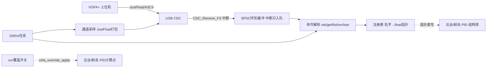

## 产品概述
为云台工程封装一个 VOFA+ 上位机调参模块（单文件模块 `application/vofa_task.c/h`）：通过板载 USB CDC 虚拟串口与 VOFA+ 通信，实现「上行波形监看 + 下行在线调 PID + 单电机阶跃测试」，要求高内聚封装、对外只暴露少量函数、尽量少改动现有代码。

## 核心功能
- **封装为独立模块**：接收、解析、发送、注册表、FreeRTOS 任务全部收进 `vofa_task.c`（internal static），其他模块只调用对外的注册/覆盖 API。
- **监看（上行）**：100Hz 周期将注册的观测通道（云台 yaw/pitch 的 set/get/gyro/out、摩擦轮转速、拨弹等）打包为 JustFloat 帧（帧尾 `00 00 80 7F`）发送，VOFA+ 直接绘制波形。
- **调参（下行）**：解析 `\n` 结尾 ASCII 命令：`set <名字> <值>`（如 `set yaw_spd_kp 3600.0`）、`get <名字>`、`list`，直接写入 PID 结构体成员立即生效，并文本回显。
- **PID 参数机制**：上电仍用原宏初始化（安全兜底）；VOFA 下发的值通过指针直写覆盖宏值 =「暂时不用宏」；调好后把最终值写回宏固化。
- **单电机测试模式**：命令 `ovr <名字> on|off` 与 `tset <值>`，逐个电机（yaw角度/yaw速度/pitch角度/pitch速度/摩擦轮/拨弹）覆盖设定值做阶跃测试，每个电机 PID 调好后再应用回宏。
- **CDC 冲突处理**：usb_task 停用每 1s 诊断打印，CDC 让给 VOFA。

## 边界约束
- 云台控制逻辑、PID 库、蜂鸣器 test_task 均不改；仅在 PID 计算点插入一行零开销覆盖调用。
- 断电不保存参数（无 EEPROM 需求），重启后回到宏值，避免比赛环境误用旧参数。
	


## 技术栈
- C 语言 + STM32F407 HAL + FreeRTOS（CMSIS-OS v1，`osThreadCreate` 模式，Src/freertos.c:146）
- 传输层：USB CDC 虚拟串口（Src/usbd_cdc_if.c 已有 `CDC_Receive_FS`/`CDC_Transmit_FS`，无需新硬件）
- 上行协议：VOFA+ JustFloat；下行协议：'\n' 结尾 ASCII 命令（VOFA+ 命令按钮原生支持）
- 构建验证：CLion 绝对路径 `cmake.exe --build --target SBV --preset Debug`

## 架构设计
单模块内部分四层（同文件内 static 隔离，对外只有 4 个 API）：



## 对外接口（vofa_task.h）
- `void vofa_task(void const *argument)`：FreeRTOS 任务入口（内部完成 USB 初始化依赖、绑定、循环）
- `bool_t vofa_reg_param(const char *name, fp32 *addr)`：注册可调参数（Kp/Ki/Kd/max_out/max_iout、设定值等）
- `bool_t vofa_reg_channel(const char *name, const fp32 *addr)`：注册监看通道
- `bool_t vofa_reg_pid(const char *prefix, void *pid, uint8_t pid_kind)`：一键注册 PID（`pid_kind` 区分 `pid_type_def` 与 `gimbal_PID_t`，注册 Kp/Ki/Kd/max_out/max_iout 五项）
- `fp32 vofa_override_apply(const char *name, fp32 default_set)`：单电机测试覆盖点；对应 `ovr` 未开启时直接返回 default_set（零开销），开启时返回 `tset` 下发的测试目标值

## 关键实现决策
1. **指针直绑而非复制**：注册 `&pid.Kp` 等成员地址，`set` 即写即生效，控制代码零改动；Cortex-M4 对齐 fp32 写入原子，无撕裂。
2. **RX 用 SPSC 环形缓冲**：`CDC_Receive_FS`（USB 中断）只 copy 入队，任务侧出队逐字节解析，中断时间最短。
3. **JustFloat 与文本共存**：VOFA+ JustFloat 引擎忽略非帧尾数据，命令回显文本直接在命令窗口查看。
4. **覆盖点插入位置**：gimbal_task.c 角度环/速度环 PID 计算前 `set = vofa_override_apply("yaw_angle", set)`；shoot.c 摩擦轮/拨弹同理由 `vofa_shoot_register()` 内的覆盖点处理；云台电机通过已有 `get_yaw_motor_point()/get_pitch_motor_point()` 绑定。
5. **shoot 静态结构**：shoot.c 的 shoot_control_t 为静态变量，在 shoot.c 内新增约 10 行注册入口函数完成 PID/通道绑定。
6. usb_task.c 停用 1s 打印（保留任务壳与 `MX_USB_DEVICE_Init`）。

## 性能与可靠性
- 100Hz × N 通道 float 打包发送，JustFloat 帧 ≤ CDC 单包 64 字节分片无压力；CDC_BUSY 时丢帧不阻塞控制任务。
- 参数写入发生在任务上下文，与 gimbal/shoot 任务并发仅涉及对齐 fp32 单写，无锁。
- 命令解析器为逐字节状态机，天然处理粘包/断包；非法命令忽略并回显错误提示。

## 修改文件清单
```
application/vofa_task.c/h   [NEW] 全部 VOFA 逻辑：注册表/协议/环形缓冲/任务/绑定
Src/usbd_cdc_if.c           [MOD] CDC_Receive_FS USER CODE 段挂一行 vofa_cdc_rx_handler
application/usb_task.c      [MOD] 停用 1s 诊断打印
application/gimbal_task.c   [MOD] 角度环/速度环 PID 计算前插入 vofa_override_apply（各一行）
application/shoot.c         [MOD] 新增 vofa_shoot_register() 注册入口 + 覆盖点
Src/freertos.c              [MOD] 创建 vofa_task（osPriorityNormal，栈512）
CMakeLists.txt              [MOD] 加入 application/vofa_task.c
```
	
